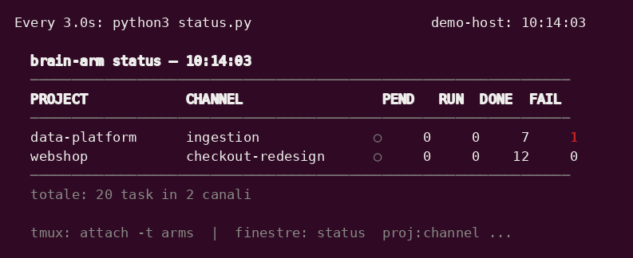
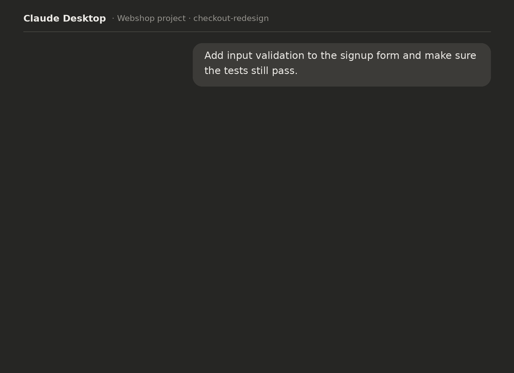
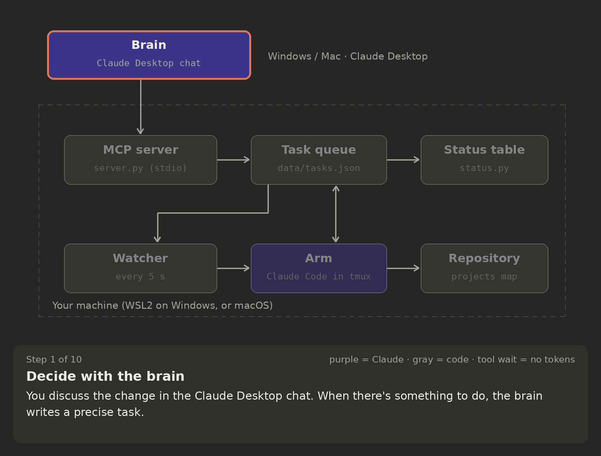

# brain-arm

**Think in Claude, execute in Claude Code.**
brain-arm lets a conversation in **Claude Desktop** (the *brain*) plan the work and delegate it, task by task,
to **Claude Code** sessions (the *arms*) that run on your machine, in your repositories — automatically,
in parallel, visibly, and within cost and safety limits.

- You discuss, decide and review with the brain. The brain never runs code.
- When there is something to do, the brain writes a precise task. A watcher starts an arm for that chat,
  the arm does the work in the right repository and closes the task with a result.
- The brain waits for the result on its own, checks it, and reports back to you.
- Every chat has its own queue (*project + channel*), so several brains and arms work side by side without
  mixing. You see everything live in a terminal dashboard and in tmux.



*The status table (made-up projects). A task appears as pending, an arm starts (●), works on it (RUN),
closes it (DONE); a second channel joins; idle arms go quiet (○).*

---

## Contents

- [Reading the status table and the logs](#reading-the-status-table-and-the-logs)
- [How the brain waits for the arm](#how-the-brain-waits-for-the-arm)
- [Cost model](#cost-model)
- [Why brain-arm](#why-brain-arm)
- [How it compares to built-in features](#how-it-compares-to-built-in-features)
- [Architecture](#architecture)
- [Tech stack](#tech-stack)
- [Installation](#installation)
- [Daily use](#daily-use)
- [Configuration](#configuration)
- [Safety and cost controls](#safety-and-cost-controls)
- [Troubleshooting and maintenance](#troubleshooting-and-maintenance)
- [Limitations](#limitations)
- [Repository layout](#repository-layout)
- [License](#license)

---

## Reading the status table and the logs

The table refreshes every 3 seconds (`watch -n3 python3 status.py`; the watcher also keeps it in tmux window 0).

| Column | Meaning |
|---|---|
| `PROJECT` | Project key, as in the projects map (`~/.brain-arm-projects.json`). |
| `CHANNEL` | The brain chat that owns the queue (one channel per chat). |
| dot | **●** green: the channel's arm is working right now (its screen changed in the last 30 s). **○** gray: an arm exists but is idle or has been closed. No dot: no arm has ever run for this channel. |
| `PEND` (yellow) | Tasks waiting for an arm. A pending task with **●** is about to be picked up; pending with **○** for minutes means something is off (see [Troubleshooting](#troubleshooting-and-maintenance)). |
| `RUN` (cyan) | Tasks an arm has started (`in_progress`). |
| `DONE` | Tasks closed successfully. |
| `FAIL` (red) | Tasks closed as failed — by the arm (e.g. a permission was denied) or by a safety rule of the watcher. The reason is in the task result. |

**Logs**

| What | Where | How to read it |
|---|---|---|
| An arm, live | `tmux attach -t arms`, then pick the `project:channel` window (`Ctrl+b w`, or `tmux attach -t arms \; choose-tree -w`) | The real Claude Code session: you see every step and can answer a prompt if one appears. Detach with `Ctrl+b d` (arms keep running). |
| An arm, history | `logs/<project>--<channel>.log` | Raw copy of the arm's screen (contains terminal escape codes). `tail -f` it to follow from another terminal. |
| The watcher | `data/watcher.log` | One line per event: `[NEW]` task seen, `[ARM]` arm started/closed, `[NOTIFY]` new task passed to a running arm, `[NUDGE]` arm reminded to close a task, `[WAIT-USER]` arm waiting for your confirmation, `[IDLE]`/`[KILL]` arm closed by a limit, `[FAIL]` tasks failed by a safety rule. |

---

## How the brain waits for the arm



*What you actually see in the brain chat: your request, a few compact tool lines while the brain waits on its own,
and a verified answer. Everything else is there only when you ask for it: the **table view** to see where tasks
stand (`watch -n3 python3 status.py`), or the arm's **live session** with every file read, diff and test log
(`tmux attach -t arms`). Made-up example.*

**You don't have to tell the brain to wait, or tell it when the arm is done.** The waiting is built into the
tools:

1. `create_task` answers with the next step: *call `wait_for_task` now*.
2. `wait_for_task` waits **inside the MCP server** for up to ~50 s per call (it re-reads the queue every 3 s).
   While it waits, the model is not running, so no tokens are spent.
3. If the task is still open it answers *"wait … in_progress for N min, call wait_for_task again now, without
   writing to the user"* — and the brain calls it again.
4. When the arm closes the task it answers *"done … now call get_result"*; the brain reads the result, checks
   it and reports to you.
5. If no arm picks the task up within 3 minutes, it tells the brain why (unmapped project, watcher down) so the
   brain can tell you once instead of waiting in silence.

The rules live in the tool descriptions and answers themselves, so they work in any chat that has the
brain-arm connector. For extra robustness put [`docs/brain-instructions.md`](docs/brain-instructions.md) in your
Claude Desktop project instructions once: it also fixes the chat's project and channel, so you never have to
repeat them.

---

## Cost model

**Tokens are spent only while a model is generating** — the brain while it answers, an arm while it works.
Everything that waits or polls is plain code reading a file.

| What happens | Who does it | Tokens |
|---|---|---|
| Checking the queue every 5 s | watcher (Python) | **0** |
| Refreshing the status table every 3 s | `status.py` (Python) | **0** |
| Waiting inside `wait_for_task` (up to `wait_window_sec`, 50 s by default) | MCP server (Python) | **0** |
| An arm sitting idle at its prompt ("ARM waiting") | nobody — it just waits for input | **0** |
| Re-calling `wait_for_task` after each *"wait"* answer | brain: one model step every ~50 s | **small** |
| Waking an idle arm for a new task (the watcher types "new tasks") | arm: one turn, then the work | small + work |
| Starting a new arm (prompt, project context) | arm: once per arm session | one-off |
| Reminding an arm that forgot to close a task (max 3) | arm: one short turn each | small, rare |
| **Doing the actual work** — reading, editing, testing | arm | **the real cost** |
| Planning, writing the task, checking the result | brain | normal chat cost |

**Arms don't poll.** An arm never checks the queue by itself: it is woken up by the watcher only when there is
something to do.

**Idle really is zero — verified.** Across 43 real arm sessions, arms sat open and idle for a total of **15.7 hours**
(longest single gap: 59 minutes) and made **0 model calls** that weren't triggered by an input (a task, a watcher
notice or a tool result). So when the table shows **no `PEND` and no `RUN`**, the arms cost nothing. A brain chat
costs nothing when it isn't answering or waiting on a task: chat apps call the model only to produce a reply.
(Claude Code may still do non-model background traffic such as update checks; it uses no tokens.)

### Measured token profile

Author's usage, 17–30 Oct 2026: 43 arm sessions, 115 tasks. Run `python3 measure.py` to get the same report on
your own data. Arm figures are **exact** (from Claude Code's local transcripts); Claude Desktop doesn't expose token
counts, so brain figures are **measured indirectly**. *Input-equivalent* weights the four token types with the
usual price ratios relative to normal input — cache write 1.25×, cache read 0.1×, output 5× (check your model's
pricing).

| Arm | Value |
|---|---|
| Input read from the prompt cache | **96.8%** (uncached input ≈ 0%, cache writes 3.2%) |
| Share of cost (input-equivalent) | cache reads 54% · cache writes 23% · output 24% |
| Context when a fresh arm starts (system prompt, tools, project files, arm prompt) | median **28k** tokens |
| Peak context per arm session | median **85k** · p90 182k |
| **Cost per task** | median **136k** input-equivalent · p90 313k |
| Context already loaded when a *later* task starts in the same open arm | median **90k** · p90 186k |

| Brain | Value |
|---|---|
| Task spec it writes | median **850** tokens · p90 1.7k |
| Result it reads back | median **980** tokens · p90 3.7k · max 6.6k |
| Task duration (created → closed) | median **1.2 min** · p90 3.8 min |
| `wait_for_task` calls per task | median **2** · p90 5 (estimated from durations; exact counts from now on in `data/metrics.jsonl`) |

**What one brain wait step costs.** Each *"wait"* answer makes the brain re-read its conversation — almost all
from cache — and write a few dozen tokens; the answer itself adds ~60 tokens to the chat. In input-equivalent
terms a step is about `0.1 × brain context + ~400`: ≈4.5k for a 40k-token brain chat. With a median of 2 steps
per task that is **~9k per task, versus ~136k for the arm doing the work**.

### Where the tokens go — bottlenecks and what to do

1. **Context carried between tasks (the biggest one).** An arm stays open after a task (`idle_exit_sec`, 1 h by
   default) so the next task starts instantly — but it starts with everything the previous tasks loaded: median
   **90k** tokens instead of **28k**, re-read at every step. *Mitigation:* set a short `idle_exit_sec` (e.g. `120`)
   in `config.local.json`. Each task then gets a fresh arm: a one-off ~35k input-equivalent to start, a few seconds
   of startup, and no memory of previous tasks (the brain's task description carries what's needed).
   For follow-up tasks this should cut the arm's cost substantially; measure it on your own usage with
   `measure.py`.
2. **Arm startup (~28k).** Every new arm loads Claude Code's system prompt, tools and the project's `CLAUDE.md`.
   *Mitigation:* keep project `CLAUDE.md` files short and to the point.
3. **Arm output (24% of the cost).** Output tokens are the most expensive kind. *Mitigation:* ask for concise
   results in the task description; long material belongs in files (e.g. `.arm_scratch/`), not in the result.
4. **Results that pile up in the brain chat.** Every result stays in the brain's context (p90 3.7k tokens) and
   every later brain step re-reads it. *Mitigation:* ask for short results; start a new brain chat per topic.
5. **Brain wait steps.** Small (median 2 per task) but they grow with the brain chat's length. *Tuning:* a longer
   `wait_window_sec` means fewer steps, with two limits: the MCP client may cut off a tool call that lasts too
   long, and the prompt cache typically expires after ~5 minutes, so windows near or above that make each step
   re-write the cache instead of reading it. 50 s is a deliberately conservative default.

Whether you pay per token (API) or work within plan usage limits, the same proportions apply.

---

## Why brain-arm

The short version: **a single agent session is a poor place to think and a poor place to keep context.**
brain-arm splits *reasoning* and *execution* into two environments, each used for what it does best, with an
explicit contract — the task — in between.

### 1. Reasoning quality: the brain's context stays clean

In an agentic session most tokens are tool output: files read, test results, stack traces, diffs. They stay in
the context, push it toward compaction, and dilute earlier decisions. In brain-arm that output **never enters
the brain's context**: the brain only sees the task it wrote and the result it gets back. Each arm, in turn,
starts fresh from a well-written task instead of inheriting a long, noisy history.

Measured on the author's usage (`measure.py`, 43 real arm sessions, 17–30 Oct 2026): the median arm session
peaked at **~85k tokens** of context (p90 ~182k), while the brain received **~1.8k tokens per task** (spec +
result) — roughly **45× less**. (An arm session may serve several tasks, so the per-task ratio is somewhat lower;
the order of magnitude holds. Details in [Cost model](#cost-model).)

### 2. Separation of powers: structural, not prompt-based

In a single Claude Code session the planner and the executor are the same agent with the same tools; plan mode
is a mode it can leave. Here the brain has **no shell and no repository access at all** — only the brain-arm
tools you configured. Every hand-off is a written task: reviewable, logged, and verified by the brain when the
result comes back. Arms run under Claude Code's permission system and auto mode; when something is blocked it
surfaces as a failed task with the reason, instead of being worked around.

### 3. The right model for each role, with separate contexts

The brain can use the strongest model with long-form reasoning; arms default to **Sonnet 5.5, medium effort**.
Unlike a single-session setup that switches model by phase, each model here has **its own context**, and arms
for different channels run **in parallel**. In the measured sessions **96.8% of arm input tokens were cache
reads**, which are billed at a fraction of normal input tokens.

### 4. Robustness: state on disk, independent lifecycles

The queue is a file, not a process: it survives crashes, restarts and closed windows. Brains live for days,
arms live for the duration of the work and are closed automatically. A dead arm loses nothing; a failed task
can be re-sent as is. The watcher starts with the OS session and restarts on failure.

### 5. Simple building blocks, explicit permissions

brain-arm is built only from simple, standard pieces: a local stdio MCP server, Claude Code with auto mode and
explicit permission rules, files, tmux and systemd/launchd. No inbound network port, no extra hosted service.
It adds cost guards, a full audit trail of delegated work, and explicit, narrow exceptions instead of blanket
permissions.

**Track record** (author's usage, Aug–Oct 2026): 758 tasks delegated, **689 done (90.9%)**, 17 where the arm
asked for clarification instead of guessing, 52 failed — of which 25 during the initial build of the tool,
20 permission/safety blocks surfaced as intended, 1 timeout, and only 6 related to the task content.

### When **not** to use it

Quick fixes, exploring an unfamiliar repo, single-file edits: a plain Claude Code session is faster.
brain-arm pays off when the work is long, spans several steps or repositories, or deserves a planning
conversation that should not drown in tool output.

---

## How it compares to built-in features

| Feature | What it does | Difference from brain-arm |
|---|---|---|
| Claude Code **subagents** | Up to ~20 helpers with isolated context inside one session | The parent is still an executor with every tool; no persistent queue; helpers live and die with the session. Great for a single complex task. |
| Claude Code **agent teams** (experimental) | A lead and teammates sharing a task list | Closest in spirit; interactive CLI only, one team per session, no resume of in-process teammates. |
| **`opusplan`** model setting | Opus plans, Sonnet executes | Same context passed between models, sequentially; no parallel workers. |
| **Cross-session messaging** | Your sessions can message each other | A transport, not an orchestrator: it doesn't launch sessions or route work. |
| **Background sessions** (`claude --bg`, preview) | Sessions running in the background with an overview | Similar to the tmux arms, without queue or routing. |
| **Plugins / mods** | Hooks and UI customizations inside a session | A customization layer, not delegation. |

Some of these may replace parts of brain-arm over time (e.g. messaging instead of tmux key injection).

---

## Architecture



*The life of a task, step by step: the highlighted components are the ones involved in each step.*

**Want to explore it yourself?** Open the [interactive architecture page](https://gloriasegurini.github.io/brain-arm-claude-mcp/architecture.html):
click any component to see what it is, or move through the steps at your own pace.
(A README can't run interactive content, so the page is published separately with GitHub Pages; you can also
open `docs/architecture.html` from your copy of the repository.)

The components never talk to each other directly: they meet on the **task queue** (a shared blackboard).

**Who starts what**

```
Windows
└─ Claude Desktop ──starts──▶ wsl …/.venv/bin/python server.py     (MCP server, stdio)
WSL2
├─ systemd --user ──starts──▶ watcher.py                            (one watcher)
│     └─ tmux session "arms"
│           ├─ window "status": watch → status.py
│           └─ one window per channel ──▶ claude (Claude Code)      (N arms)
│                                              └─ python3 arm_helper.py …
└─ everyone reads/writes data/*.json through store.py (inter-process lock + atomic writes)
```

**Life of a task — click a step to expand it**

<details><summary><b>1. Decide with the brain</b> · Brain</summary>

You discuss the change in the Claude Desktop chat. When there's something to do, the brain writes a precise
task: goal, constraints, files, and how to tell it worked.
</details>

<details><summary><b>2. <code>create_task</code></b> · Brain → MCP server → queue</summary>

The brain calls `create_task(title, description, project, channel)`. The server refuses it if project or
channel are missing or `default`; otherwise it appends the task to `tasks.json` as **pending** and answers
*"NEXT STEP: call wait_for_task now"*.
</details>

<details><summary><b>3. The brain starts waiting</b> · Brain ↔ MCP server</summary>

`wait_for_task` blocks **inside the server** for up to ~50 s, checking the queue every 3 s — no tokens are
spent while it blocks. If the task isn't finished it answers *"wait … call again now"* and the brain calls it
again: one short step every ~50 s. See [How the brain waits](#how-the-brain-waits-for-the-arm).
</details>

<details><summary><b>4. The watcher sees the task</b> · queue → watcher</summary>

Within 5 s the watcher (plain Python, no model) reads the pending task. The status table shows it in `PEND`.
</details>

<details><summary><b>5. An arm starts, or is notified</b> · watcher → arm</summary>

If the channel has no arm, the watcher opens a tmux window and starts Claude Code in the mapped folder with the
arm prompt. If an arm is already open and idle, it types *"new tasks: start again from get"* into it — unless a
confirmation dialog is open, in which case it waits.
</details>

<details><summary><b>6. The arm takes the task</b> · arm → queue</summary>

`arm_helper.py get`, then `start`: the task becomes **in_progress** (`RUN`) and the dot turns ●.
</details>

<details><summary><b>7. The arm works</b> · arm → repository</summary>

It reads, edits and tests in the repository. Every action goes through Claude Code's permissions and the
auto-mode classifier.
</details>

<details><summary><b>8. The arm closes the task</b> · arm → queue</summary>

`arm_helper.py done` (or `fail`) with the result — long results via stdin. Then it writes *"ARM waiting"* and
stops; an idle arm costs nothing. If it forgets to close the task, the watcher reminds it.
</details>

<details><summary><b>9. The brain reports</b> · MCP server → brain → you</summary>

`wait_for_task` answers **done**; the brain calls `get_result`, checks the outcome against the goal and
reports to you. You never had to say "it's done".
</details>

<details><summary><b>10. Housekeeping</b> · watcher</summary>

An arm idle for 1 h is closed; one working 60 min without a pause, or stuck at startup for 10 min, is closed and
its tasks fail; at most 5 arms run at once (all configurable).
</details>


**Brain tools** (MCP): `set_mode`, `get_mode`, `create_task` (project and channel are mandatory),
`wait_for_task`, `get_result`, `check_updates`, `list_channels`, `get_tasks`, `update_task`,
`write_context` / `read_context` / `clear_context`, `log` / `get_log`.

**Why arms don't use MCP:** depending on its configuration, the CLI may not load user MCP servers. Arms use
`arm_helper.py`, a tiny command (`get`, `start`, `done`, `fail`, `write_context`) that works with any Claude
Code installation. Long results are piped through stdin (`… | arm_helper.py done ID -`).

---

## Tech stack

| Layer | Technology | Why |
|---|---|---|
| Brain | Claude Desktop (Windows) | Long conversations, project knowledge, document upload, organization connectors. |
| Protocol | **MCP** over **stdio** — official Python SDK `mcp` ≥ 2.1 (`MCPServer`) | Standard way to give tools to Claude apps; stdio means Desktop launches the server as a child process — no network port. |
| Server | `server.py` (Python 3.10+) | Exposes the brain tools; every write goes through `store.py`. |
| Shared state | JSON files in `data/` + `store.py` (`fcntl` lock, atomic replace) | Inspectable, no database to install, survives restarts; the lock prevents lost updates between concurrent writers (see `tests/test_store_concurrency.py`). |
| Orchestration | `watcher.py` (Python standard library only) | Launches, notifies, nudges and closes arms; enforces limits. |
| Arms | Claude Code CLI (recent version), interactive, `--permission-mode auto` | Real repository access with Claude Code's permission system and auto-mode classifier. |
| Process host | **tmux** | Keeps interactive sessions alive without an open terminal; attach to watch; `pipe-pane` writes the logs. |
| Service | **systemd** user service in **WSL2** | Starts the watcher with WSL, restarts it on failure; `KillMode=process` keeps arms alive across watcher restarts. |

---

## Installation

👉 **Follow the step-by-step guide: [INSTALL.md](INSTALL.md)** — separate paths for **Windows** and **Mac**,
written for people who have never used a terminal (about 20 minutes).

---

## Daily use

- **New brain chat**: give it the instructions from `docs/brain-instructions.md` with its project and
  channel; it calls `set_mode("implement")` and saves its identity at the start of each session.
- **Watch**: `watch -n3 python3 ~/brain-arm/status.py`; live arms with `tmux attach -t arms`.
- **An arm's history**: `tail -f ~/brain-arm/logs/<project>--<channel>.log` (how to read table and logs:
  [Reading the status table and the logs](#reading-the-status-table-and-the-logs)).
- **Add a project**: `./add-project.sh <project>[:<channel>] <folder>`; list them with `./add-project.sh --list`.
- **Stop**:

  | Command | Effect |
  |---|---|
  | `./stop-arms.sh` | Stop everything: watcher, arms, pending tasks marked failed, tmux closed. |
  | `./stop-arms.sh --pending` | Kill running arms and fail pending tasks; watcher and tmux stay up. |
  | `./stop-arms.sh <project> <channel>` | Stop one channel's arm and fail its pending tasks. |

- **Verify nothing is running**: `pgrep -af "ARM for project"` (no output) and 0 pending / 0 in_progress
  in the table.
- **Measure**: `python3 measure.py` — arm tokens vs. what reached the brain, cache share, task outcomes.

---

## Configuration

Defaults live in `config.py`; put overrides in `config.local.json` (git-ignored, see
`examples/config.local.example.json`).

| Key | Default | Meaning |
|---|---|---|
| `arm_model` / `arm_effort` / `arm_permission_mode` | `claude-sonnet-5-5` / `medium` / `auto` | How arms are started. |
| `max_concurrent` | 5 | Maximum arms at the same time. |
| `idle_exit_sec` | 3600 | Close an arm after this long without tasks. |
| `max_runtime_sec` | 3600 | Close an arm after this long working without a pause (its tasks fail). |
| `startup_timeout_sec` | 600 | Close an arm that hasn't picked up a task in this time (e.g. stuck on a prompt). |
| `fast_exit_sec` / `max_failures` / `failure_reset_sec` | 30 / 3 / 300 | 3 arms exiting within 30 s in a row → the channel's pending tasks fail and it pauses 5 min. |
| `stuck_nudge_sec` / `stuck_renudge_sec` / `stuck_max_nudges` | 180 / 900 / 3 | Remind an arm that left a task in progress while idle. |
| `wait_window_sec` | 50 | How long one `wait_for_task` call waits before answering "wait" (see [Cost model](#cost-model)). |
| `poll_seconds`, `tmux_session`, `projects_file` | 5, `arms`, `~/.brain-arm-projects.json` | Watcher loop, tmux session name, projects map. |

---

## Safety and cost controls

- **An idle arm costs nothing**: it sits at its prompt; tokens are spent only while it works. The watcher and
  the table are plain scripts that read a file.
- **Watcher limits** (see [Configuration](#configuration)): max concurrent arms, idle close, max continuous
  runtime, startup timeout, crash-loop pause.
- **No unmapped work**: tasks for a project without a folder, or with project/channel `default`, fail
  immediately with an explanation instead of starting an arm in your home directory.
- **Never types into a dialog**: before sending anything to an arm (new-task notice, reminder) the watcher
  checks the screen; if a confirmation dialog is open it waits and logs `[WAIT-USER]`, so it can never pick
  an option for you.
- **Forgotten tasks**: if a task stays in progress while the arm's screen is idle, the watcher reminds it (up
  to 3 times); the runtime limit remains the backstop.
- **Brain waiting**: `wait_for_task` blocks server-side up to ~50 s per call (no tokens while waiting) and every
  answer tells the brain the next step; if no arm picks the task up within 3 minutes it returns a diagnosis.
- **Auto mode stays on**: only the explicit, narrow DEV/TEST rule is added. Attempts to route around a block are
  themselves blocked by the classifier — by design.
- **Kill switch**: `./stop-arms.sh`.
- **Publishing hygiene** (for forks): `.gitignore` excludes `data/`, `logs/`, local config and `.env`.

---

## Troubleshooting and maintenance

| Symptom | Cause and fix |
|---|---|
| Arms keep asking for approvals | Auto mode is unavailable in old Claude Code versions (`auto mode unavailable` at startup). Update: `sudo npm i -g @anthropic-ai/claude-code@latest`. If Claude Code is installed in a root-owned prefix its self-update can't write there — update it periodically by hand. |
| A task stays `pending` with ○ | Project/channel not in the projects map, watcher stopped (`systemctl --user status brain-arm-watcher`), or the arm is stuck on the folder-trust prompt (trust the folder once). `wait_for_task` reports this after 3 minutes. |
| Claude Desktop: "not a valid MCP server configuration" | Use the `command: "wsl"` form, not `url`. Quit Desktop from the tray after editing the config. |
| `create_task` refused | project/channel missing or `default`: set the chat identity (see `docs/brain-instructions.md`). |
| Task blocked by the auto-mode classifier | Working as intended. Run the step yourself, or add a narrow rule (see `automode_devtest.py`). Don't route around it. |
| Restarting the watcher | `systemctl --user restart brain-arm-watcher` — running arms are kept and re-adopted. |

---

## Limitations

- The brain can't see the code directly: it relies on recon tasks and on what arms report.
- Delegation adds latency; for small changes a direct Claude Code session is faster.
- Built and tested on Windows + WSL2 + Ubuntu; plain Linux/macOS should need little change but are untested.
- The brain spends a little while waiting (one short step every ~50 s while a task runs).

---

## Repository layout

```
server.py            MCP server for the brain (stdio)
watcher.py           launches/notifies/nudges/closes arms in tmux; enforces limits
arm_helper.py        the arms' interface to the queue
store.py             inter-process lock + atomic JSON writes
config.py            defaults; overrides in config.local.json
status.py            status table
stop-arms.sh         stop everything / one channel / pending only
install.sh           installer for Windows+WSL2, macOS, Linux (--check to only verify)
add-project.sh       map a project (or project:channel) to its folder
INSTALL.md           step-by-step installation guide
launchd/             watcher LaunchAgent template (macOS)
automode_devtest.py  optional auto-mode rule for DEV/TEST environments
measure.py           usage and outcome metrics
systemd/             watcher service template
examples/            projects map, local config, Claude Desktop config
docs/                brain instructions, interactive architecture page, demo GIFs and their generators
tests/               concurrency test, end-to-end brain/arm test
```

---

## License

[MIT](LICENSE) © 2026 Gloria Segurini — free to use, modify and share, keeping the copyright notice.
Provided as is, without warranty. brain-arm is an independent project, not affiliated with or endorsed by Anthropic.
